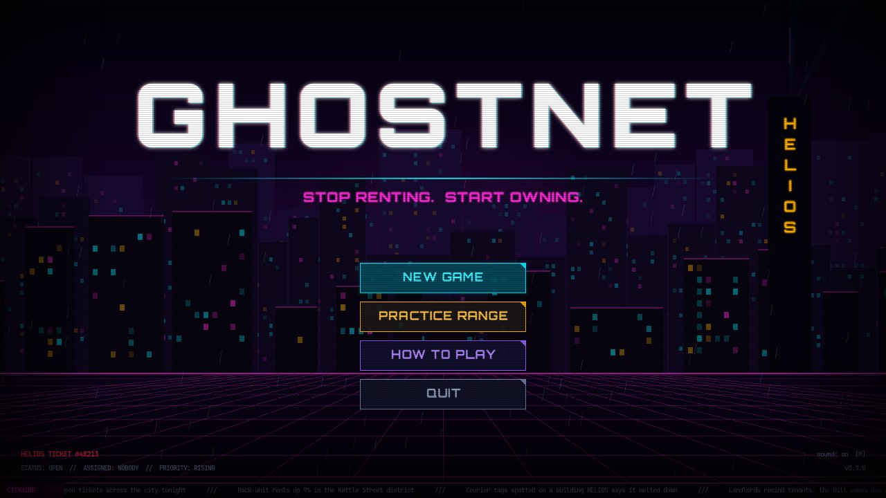
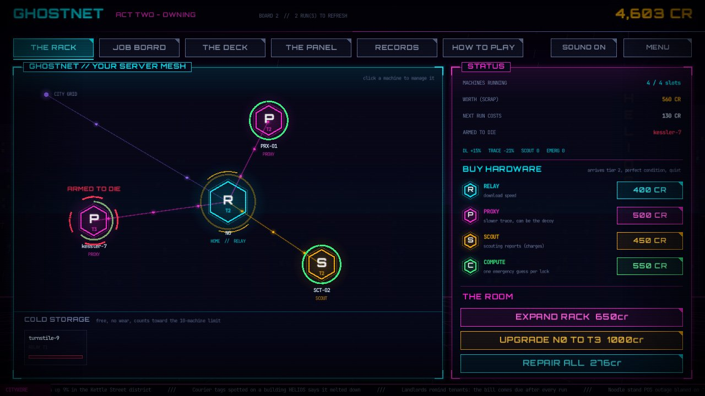
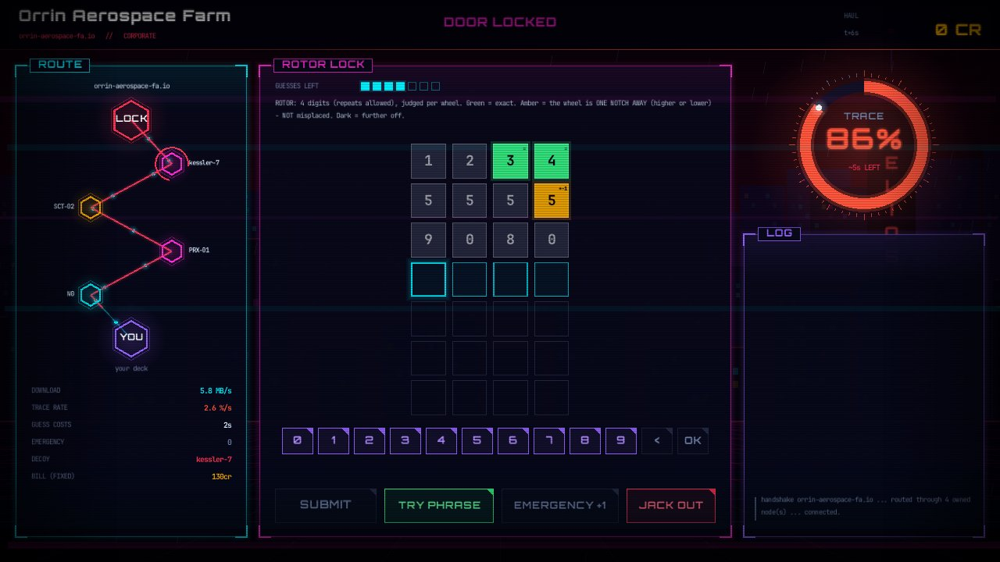
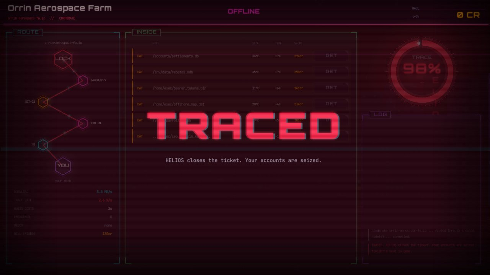

# GhostNet

> *A game about a runner who stops renting and starts owning.*

**GHOSTNET** is a neon hacking game for Windows, written in C++17 on raylib. In
this city, server space is real estate. You rent a room called THE RACK, take
jobs off the board, and break into servers before HELIOS (the maintenance corp
whose trace meter is "how long you've been an open ticket") closes your ticket.
Then you find what the dead courier SAINT left behind: a salvaged 3-slot rack
and a home server, **N0**. From there you build a network you own, and every
machine in it bills you, wears out, and can die in your place. The goal is to
survive, then pull off **the deep job**. After that, **the Ledger** puts the
towers that set your rent on your board.

It runs in its own window: a rain-soaked skyline, a live mesh graph of your
machines, lock grids that light up green and amber, a trace ring that turns red
as HELIOS closes in, and synthesised sound. Every screen is clickable, and
everything you type can be typed.

| | |
|---|---|
|  |  |
|  |  |

It is built from the concept doc *"GHOSTNET: A game about a runner who stops
renting and starts owning"*. A [design panel of AI reviewers](DESIGN_PANEL.md)
proposed improvements, and each one was checked against the doc's own rules.

## Download & play (Windows)

1. Go to **[Releases](https://github.com/Cilis1/GhostNet/releases/latest)** and download **`GhostNet-Setup.exe`**.
2. Run it. It downloads the game from this repository's release over HTTPS,
   checks every file's SHA-256, installs to `%LOCALAPPDATA%\Programs\GhostNet`
   (no admin needed) and adds a Start Menu shortcut.
3. Run it again any time to update or repair. Use `GhostNet-Setup.exe --uninstall` to remove the game (your saves are kept).

The exe isn't code-signed yet, so SmartScreen may warn you. Check the hash in
the release notes, then click *More info → Run anyway*. See
[SECURITY.md](SECURITY.md) for exactly what the downloader checks.

## How it plays

```
THE RACK -> JOB BOARD -> pick a listing -> briefing (scan it, hear the Panel) -> CONNECT
  the door   break the lock in limited guesses, or TRY PHRASE if you've read one
  inside     OPEN to read a file, GET to download it, CAPTURE HARDWARE, JACK OUT
THE RECKONING -> haul, fines, the bill, wear, machines going dark
```

**Controls:** mouse for everything. At a lock, type digits or letters and press
**Enter**; **Backspace** fixes. **Esc** opens the menu (save & quit, practice,
retire) or closes a dialog. **F11** toggles borderless fullscreen. **M** on the
title screen mutes. The **Practice range** on the title screen lets you learn
all four locks with no trace and no bill.

* **Four acts.** *Renting* ends at your first trace-out. *Owning* starts with
  your first captured machine. *The Deep Job* starts when a decoy first dies for you.
  *The Ledger* opens after the owner ending.
* **Trace-out:** your accounts are seized, so the night's haul is lost. You pay a fine
  (never more than you have), the bill still comes due, and your machines wear hard.
* **Downloading** takes time and makes you easier to find: the trace runs ×1.25 while bytes move.
* **Locks:** every lock is judged box by box. Keypad and Cipher: green = right box,
  amber = in the code but another box. Rotor: amber `+-1` = one notch away, *not* misplaced.
  A passphrase opens a door without breaking it. **TRY PHRASE** shows rotating stock
  starter phrases (and any phrase you've read) to click; each wrong one still costs 2s and +5% trace.
* **The deck:** tools you buy for yourself (Breaker, Uplink, Shroud, Lens). They are
  permanent, never billed, and separate from the network.
  * **Programs:** two single-use slots, loaded between runs and run from the connection
    screen at no time cost. Only one may run against a given lock; unused ones refund in full.
    FREEZE 120 (trace stands still 4s), PEEK 90 (reveal one box of the lock), SPOOF 80
    (the next bait file is defused), BURST 70 (next 5 download seconds at ×2, trace ×1.5).
* **GhostNet** (unlocks after your first contract): N0 plus up to 14 machines.
  * **Relay** speeds downloads.
  * **Proxy** slows the trace.
  * **Scout** gives target reports and reveals `[HW]` listings.
  * **Compute** holds one emergency extra guess.
  * **Jammer** holds a watchdog's acceleration back (20/30/45s by tier, network cap 60s)
    and softens lockout, wrong-phrase and honeypot spikes (20/30/40%, cap 50%).
  * **Vault**: if you're traced out, your best working vault keeps 60/80/100% of your
    single most valuable downloaded file.
  * **Gateway** opens a subnet (see below).
  * Bought machines are clean tier 2: Relay 400, Jammer 425, Scout 450, Vault 475, Proxy 500, Compute 550, Gateway 700.
  * **Origin traits** are fixed for life on captured machines: *Salvaged* (open servers:
    repairs 1cr/pt, +2 wear), *Old Net* (hidden: wear never drops it below 30 except on a
    trace-out, re-jobs cost double), *Hot Iron* (guarded: fine waived if it dies as your
    decoy, bills +10%), *Corporate Build* (corporate: 60% wear, bills +20%).
  * Tier 3 comes only from upgrading N0 or stealing corporate iron.
  * **Prototypes (tier 4):** rare HELIOS black-site listings (security 4, a watchdog and a bait
    file) hold the only real tier 4 in the city. It is *Unstable* for life: double wear,
    repairs at 3cr/pt and bills +40%.
* **Subnets** (0.5): a running **Gateway** in the main rack opens a separate bay of 3 slots
  (up to 2 subnets). Machines plugged into it don't use main-rack slots.
  * Each subnet has its own **power budget** (5/7/9/12 by gateway tier; a member draws
    1/2/3/5 by tier). Over budget it browns out. It also has its own **bill**, its own relay
    and proxy caps (30% / 18%, under hard caps of 90% / 50%), and a **power switch**.
    Switched off, it doesn't bill, wear or do anything.
  * **Roles**, set between runs: STEALTH (trace slower), SPEED (downloads faster), SIEGE
    (+1 emergency attempt, softer alarm spikes).
  * **Strikes:** once per run, each subnet that was online when you connected can strike
    to match its role. BLACKOUT freezes the trace 8s, MIRROR lands 12s of the current
    download at once, and CRACK reveals 2 boxes of the lock. A strike costs no time, but
    every machine in that subnet takes 8 wear after the run.
  * **Clusters:** three matching tier 3+ machines in one subnet act one tier higher (T4, or
    T5 from prototypes) *while they're together*. Nothing is merged: pull one out and the
    bonus ends.
  * If a subnet's bill can't be paid, only that subnet powers down. Arm its **gateway as the
    decoy** and the whole subnet burns with it. Every machine gets a nameplate, and the fine
    is waived.
* **The bill:** running machines bill you after a run that does something. If you can't
  pay, nothing is taken and everything except N0 goes dark. There is never debt.
* **Decoy:** arm a Proxy (or a whole subnet, by its Gateway). If the trace fills, HELIOS traces it instead of you. The decoy
  is destroyed, the fine is halved, and you keep the night. Its nameplate goes on the
  **Memorial Wall** in Records.
* **The deep job** is tuned so that no deck alone can finish it. You can try it as soon
  as it appears. If you fall short, the game tells you by how much.
  * **Owner ending:** finish the deep job and retire as an owner.
  * **Renter ending:** walk away and be filed as a runner who kept renting.
  * Neither ending is a loss.
* **Act IV: the Ledger** (0.6) opens once you've finished the deep job. The owner ending
  now offers **THE LEDGER**, and a card puts two corp towers on your board. Each has
  3 floors; the third is the Boardroom, and taking it means you own the tower. A tower is
  never timed and never moves on its own: you start every climb, and a floor you've taken
  stays taken.
  * **Doctrines** are always announced on the board and in the briefing, never sprung
    mid-run. Each tower is built against a different build, so one deck rarely takes both.
    * **Kessler-Maru, FORTRESS.** Every door is a **composite lock**, and there are no
      maintenance ports (so no phrase). You get one guess for the whole door, plus one per
      Breaker level. Each compute box (and a SIEGE subnet) answers *once* per door. Every
      miss is logged as an alarm ping (+4% trace).
    * **Tidewater BioSys, BIOSENTINEL.** Ordinary locks, but a watchdog on every floor and a
      **sentinel sweep** every 12s (+6% trace). Jammers soften a sweep but can't delay it;
      FREEZE lets one pass. Each floor's facilities memo names the next floor's
      maintenance phrase.
  * **Composite lock:** one door, two stages, one guess budget. First a keypad (4 different
    digits, judged as usual). Once it opens, a rotor wakes, and every wheel sits within 2
    notches of the keypad digit in the same box. The screen shows the carried code and
    each box's range, and both stages give their own feedback.
  * **Heist prep** is paid for once and kept: a **FLOOR PLAN** (350cr) is a full-quality
    report, and a **MAINTENANCE PHRASE** (700/1000/1400cr, Biosentinel only) opens the
    door outright.
  * **Re-key:** the only thing a tower does to you is react to a trace. Get traced on a floor
    and that tower re-keys every door: phrases you held for it go stale. Floor plans and
    taken floors are kept.
  * Floors pay 1500 / 2500 / 9000cr. Records shows your progress on the Ledger. Saves from
    any earlier version carry over (save format v5).
* **The Panel:** VESPER (risk), LEDGER (money) and MOTH (intel) are advisor AIs. They read
  your meters and vote before each run. They never solve a lock.
* **Never in this game:** idle income, offline progress, build timers, raids, a second currency, gacha or levelling.

## Troubleshooting

* **Clicks don't land / the game ignores the mouse:** fixed in 0.3.1. Version 0.3.0 mis-mapped the mouse on Windows displays scaled above 100% (most laptops). Run `GhostNet-Setup.exe` again to update.
* **The window won't open:** GhostNet needs OpenGL 3.3, so update your graphics driver. The game writes `ghostnet.log` to `%APPDATA%\GhostNet` every time it starts; include it if you report a problem.

## Build from source

A C++17 compiler and CMake 3.22+. CMake downloads raylib 6.2 (pinned by SHA-256)
the first time.

```bash
cmake -S . -B build -DCMAKE_BUILD_TYPE=Release
cmake --build build --config Release
./build/GhostNet          # build\Release\GhostNet.exe on Windows
```

On Windows this also builds `GhostNet-Setup.exe`. Linux needs the usual X11/GL
development packages for raylib (`libx11-dev libxrandr-dev libxinerama-dev
libxcursor-dev libxi-dev libgl1-mesa-dev`).

`-DGHOSTNET_HEADLESS=ON` builds on raylib's software renderer with no window at
all, for CI. That build only takes `--shots DIR`.

**Command line:** `--windowed` (default), `--fullscreen`, `--mute`,
`--save-dir DIR`, `--shots DIR` (render a tour of every screen to PNGs and exit),
`--autoplay` (play the UI with scripted clicks and typing, then exit), `--version`, `--help`.

## Tests

* `ctest --test-dir build` runs:
  * the installer's JSON / manifest / file-name validation tests;
  * `ghostnet_sim`, an automated player (`tests/sim_bot.cpp`) that plays the real rules end to end. It solves locks only from their feedback and learns passphrases only by reading files. There are five modes: `careful`, `chaos` (lockouts, trace-outs, decoy sacrifices, unpaid bills), `deep`, `subnet` (gateways, strikes and prototype captures over 70 runs), and `tower` (Act IV). Tower mode plays on past the deep job into the Ledger. Then it runs *kit trials*: an owner with the kit matched to a tower's doctrine must take all 3 floors of both towers, and a single build sent against the wrong doctrine must fail. Deep fails unless the bot builds a network and beats the deep job, after one doomed early attempt that checks the shortfall readout.
* `gui_autoplay` (headless builds): the game plays its own UI through a simulated 1600×1000 window using only mouse clicks and typing: practice range, new game, every hub tab, the first contract (lock typed and clicked), the reckoning, naming N0, buying, storing and switching on a machine, save & quit, continue, then the Act IV card, buying a floor plan and solving a composite lock (keypad clicked, rotor typed). A dead button or mouse mapping that misses fails the build.
* `build/GhostNet --shots shots` drives every screen of the actual front end and saves 35 screenshots. CI does this on every push and uploads them as the **screenshots** artifact.
* `GhostNet-Setup.exe --selftest`: the downloader's offline security self-test.

## Releasing

Push a tag like `v0.3.1`. `.github/workflows/build.yml` then:

1. on Linux, builds the headless game, runs the tests and a 17-seed bot sweep, and renders the screenshot tour; on Windows, builds with MSVC and the static runtime, so there are no DLLs;
2. publishes a release with `GhostNet.exe`, `README.txt`, `THIRD-PARTY-NOTICES.txt`, `ghostnet-manifest.txt` (SHA-256 of every file, signed if a key is configured) and `GhostNet-Setup.exe`;
3. downloads that published installer on a fresh Windows runner and does a real install → run → verify → uninstall.

## Layout

```
src/core/        the rules: pure C++17, no I/O, no graphics
  balance.h      every tunable number
  run.cpp        a connection: locks, reading, downloads, capture, decoy, the reckoning
  rack.cpp       owning machines: buy, store, re-job, repair, scrap, decoy, the deck
  world.cpp      job board, contracts, the deep job, the Ledger's towers, side routes, shrines
  intel.cpp      scouting reports, heist prep and the Panel's advisor AIs
  locks.cpp      keypad, rotor, cipher and the two-stage composite
src/gui/         the windowed game (raylib)
  gfx.cpp        palette, fonts, glow text, panels, the city, the CRT pass
  app.cpp        title, intro, endings, dialogs    hub.cpp  rack / board / deck / panel tabs
  connect.cpp    the connection and the reckoning  audio.cpp synthesised sound
  tour.cpp       the scripted screenshot tour
src/installer/   GhostNet-Setup.exe (WinHTTP + CNG, no third-party code)
tests/           installer tests, the playtest bot
tools/           manifest + signing tools
packaging/       README.txt and third-party notices shipped with the game
res/             fonts (OFL), icon, version info, asInvoker manifest
```

## Credits

Built on [raylib](https://www.raylib.com/) (zlib licence). Fonts: Orbitron by
Matt McInerney and JetBrains Mono, both under the SIL Open Font License 1.1.
Full texts in [`packaging/THIRD-PARTY-NOTICES.txt`](packaging/THIRD-PARTY-NOTICES.txt).
